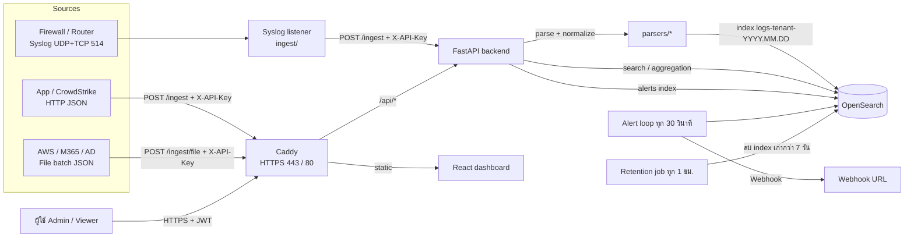

# Architecture

## ภาพรวม Data Flow

## Components

| Component | หน้าที่ |
|---|---|
| **Caddy** | เสิร์ฟหน้าเว็บ static, proxy `/api/*` ไป backend (ตัด prefix `/api`), ออก/ต่ออายุใบรับรอง HTTPS อัตโนมัติ (Let's Encrypt เมื่อมีโดเมน, internal CA เมื่อเป็น `localhost`) |
| **backend (FastAPI)** | Auth, ingest, normalize, search/aggregation, alert, retention |
| **ingest (syslog listener)** | รับ Syslog UDP/TCP พอร์ต 514 แล้วส่งต่อเข้า `POST /ingest` เพื่อให้ parse/normalize ที่เดียวกับทุกแหล่ง |
| **OpenSearch** | เก็บ log และ alert, ค้นหา, aggregation (ไม่เปิดพอร์ตออกนอก Docker network) |
| **frontend (React)** | Login, Dashboard (Timeline, Top N, ตารางค้นหา, ตัวกรอง), หน้า Alerts |

## Ingestion

| ช่องทาง | โปรโตคอล | แหล่งที่รองรับ |
|---|---|---|
| Syslog | UDP + TCP 514 | firewall, network (router) |
| HTTP JSON | `POST /ingest` | api, crowdstrike, aws, m365, ad (และ firewall/network ผ่าน field `message`) |
| File batch | `POST /ingest/file` (JSON array หรือ NDJSON) | aws, m365, ad และอื่นๆ |

การ route ไป parser ใช้ฟิลด์ `source` ของ payload (`api, crowdstrike, firewall, network, aws, m365, ad`) ความล้มเหลวของ parser ตอบ `400` พร้อมสาเหตุ และการอัปโหลดไฟล์จะรายงานรายการที่ล้มเหลวแยกรายบรรทัด

## Normalization

ทุก source ถูกแปลงเป็น Schema กลางใน [schema.md](schema.md) ตัวอย่างการ map

| ต้นทาง | ฟิลด์เดิม | ฟิลด์กลาง |
|---|---|---|
| Firewall syslog | `src` `dst` `spt` `dpt` `proto` `policy` | `src_ip` `dst_ip` `src_port` `dst_port` `protocol` `rule_name` |
| API / M365 / AD / AWS | `ip` | `src_ip` |
| AD | `event_id` 4624 / 4625 | `event_type` LogonSuccess / LogonFailed, `action=login`, `event_subtype=<event_id>` |
| AWS CloudTrail | `eventName` Create* / Delete* | `action` create / delete |
| ทุกแหล่ง | ข้อความ/JSON ต้นฉบับ | `raw` (เก็บเป็นสตริง) |

## Tenant Model

- ทุก event มีฟิลด์ `tenant` (บังคับ, แปลงเป็นตัวพิมพ์เล็กตอน ingest)
- **Index แยกต่อ tenant ต่อวัน**: `logs-{tenant}-{YYYY.MM.DD}` (multi-tenant ระดับ index)
- ผู้ใช้อยู่ใน `data/users.json` มี `role` และ `tenants` (admin = `["*"]`)
- JWT เก็บ `sub`, `role`, `tenants` เป็น claim แล้ว **backend บังคับกรองจาก claim เสมอ**
- การป้องกันสองชั้นในทุก query: (1) จำกัด index pattern เฉพาะ `logs-{tenant}-*` ของผู้ใช้ และ (2) ใส่ `terms` filter ที่ฟิลด์ `tenant`
- Viewer ที่ขอ tenant อื่นจะได้ `403`; ไม่มี token ได้ `401`
- Alert อยู่ใน index `alerts` แยกจาก log และถูกกรองตาม tenant ในรูปแบบเดียวกัน

## Security

| หัวข้อ | การทำงาน |
|---|---|
| AuthN | `POST /auth/login` ตรวจรหัสผ่านด้วย bcrypt, ออก JWT (HS256, อายุ 8 ชม.) |
| AuthZ / RBAC | `admin` เข้าถึงทุก tenant และเรียก `/admin/*`; `viewer` เห็นเฉพาะ tenant ของตน |
| Ingest | ใช้ API key (`X-API-Key`) แยกจาก JWT เพราะผู้ส่งเป็นระบบ ไม่ใช่คน |
| TLS | Caddy เปิด HTTPS เสมอ (SaaS ใช้ใบรับรองจริง, Appliance ใช้ self-signed) |
| Network | OpenSearch และ backend ไม่เปิดพอร์ตออกนอก เปิดเฉพาะ 80, 443, 514 |
| Secrets | `.env` และ `data/users.json` ไม่อยู่ใน Git |

## Alerting

- กฎ `repeated-login-failure`: `event_type` เป็น `app_login_failed` หรือ `LogonFailed` จาก `src_ip` เดียวกัน ตั้งแต่ N ครั้ง (ค่าเริ่มต้น 5) ภายใน 5 นาที แยกตาม tenant
- Background task ตรวจทุก 30 วินาทีด้วย aggregation (tenant → src_ip, `min_doc_count`)
- กันแจ้งซ้ำ: ไม่สร้าง alert ใหม่ถ้ามีของ tenant + IP เดียวกันในช่วงหน้าต่างเวลา
- ช่องทางแจ้ง: หน้า Alerts ใน UI และ Webhook (`ALERT_WEBHOOK_URL`) ทดสอบกับ webhook.site แล้ว
- ปรับค่าได้ผ่าน `ALERT_THRESHOLD`, `ALERT_WINDOW_MIN`

## Retention

- ค่าเริ่มต้น 7 วัน (`RETENTION_DAYS`)
- Job ทำงานทุกชั่วโมง ลบทั้ง index `logs-*` ที่วันที่ในชื่อเก่ากว่ากำหนด (ลบทั้ง index จึงเร็วและไม่ทำให้ index บวม)
- Admin สั่งรันทันทีได้ที่ `POST /admin/retention/run`
- Index `alerts` ไม่ถูกลบโดย job นี้

## เหตุผลการเลือกเทคโนโลยี

| ตัวเลือก | เหตุผล | ทางเลือกที่พิจารณา |
|---|---|---|
| OpenSearch | Full-text + aggregation ครบ, index รายวันต่อ tenant ทำ retention และแยก tenant ได้ตรงไปตรงมา | ClickHouse (เร็วมากแต่ search ข้อความอิสระน้อยกว่า), Postgres+GIN (เบาแต่ aggregation ช้ากว่าเมื่อข้อมูลโต) |
| FastAPI | ภาษาเดียวกับ parser และ listener, เขียน test ง่าย, dependency injection เหมาะกับ auth | Express, NestJS |
| Parser เขียนเอง | ควบคุมการ map ฟิลด์และ unit test ได้ชัด | Vector/Logstash (ต้องเรียนรู้ DSL เพิ่ม ใน 10 วัน) |
| React + Recharts | ทำ Top N / Timeline ได้เร็ว คุมสิทธิ์ tenant ที่ฝั่ง API ได้ | Grafana/OpenSearch Dashboards (ผูก auth/tenant ยากกว่า) |
| Caddy | HTTPS อัตโนมัติ ตั้งค่าไม่กี่บรรทัด | Nginx + certbot |
| Docker Compose | ไฟล์เดียวใช้ได้ทั้ง Appliance และ SaaS ต่างกันแค่ `.env` | Kubernetes/Helm (เกินความจำเป็นสำหรับเดโม) |

## Trade-offs และงานต่อยอด

- ผู้ใช้เป็นไฟล์ JSON → ควรย้ายไป DB/IdP (OIDC) เมื่อใช้งานจริง
- Syslog 1 listener = 1 tenant → ถ้าต้องรองรับหลาย tenant แยกพอร์ตต่อ tenant หรือใช้ tag ในข้อความ
- OpenSearch single-node ไม่มี replica → production ควรเป็น cluster และเปิด security plugin
- ยังไม่มี GeoIP enrichment, CI/CD, IaC (ระบุเป็นงานถัดไป)
